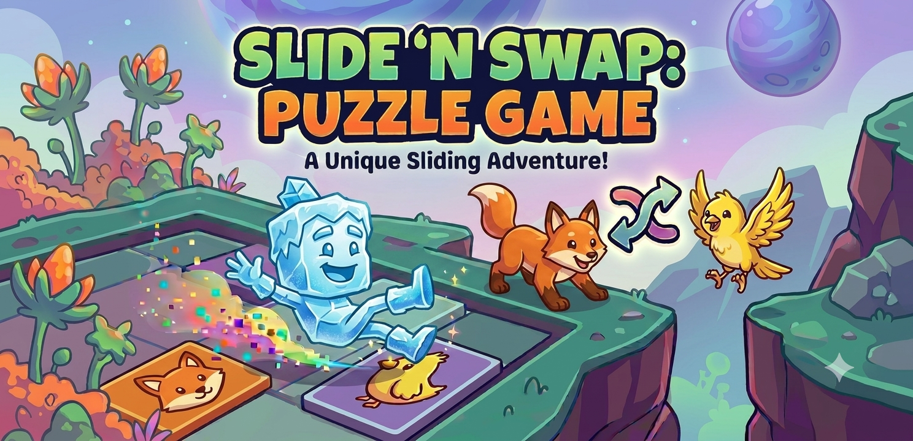
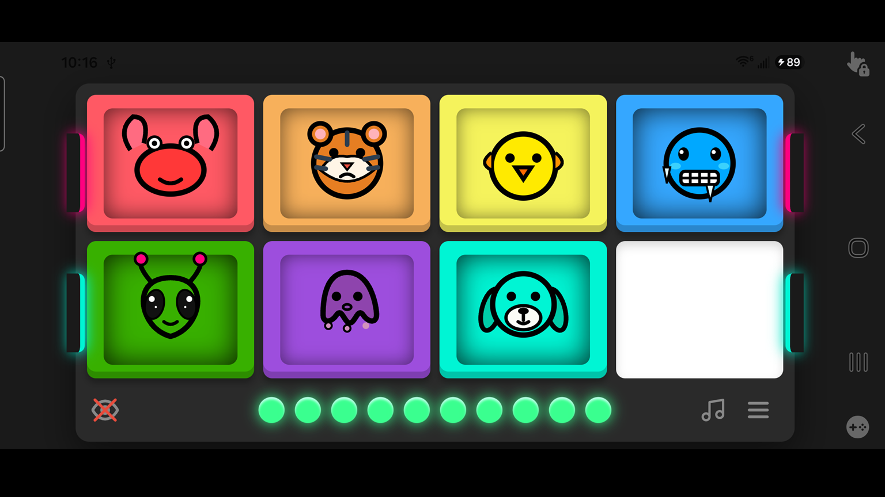
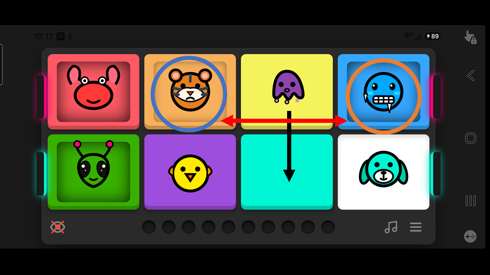
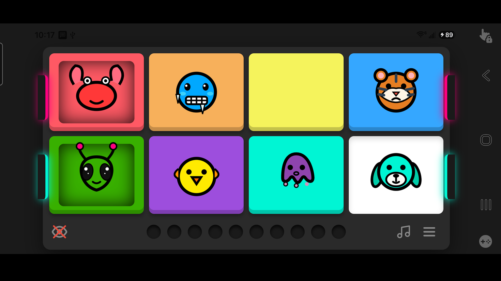
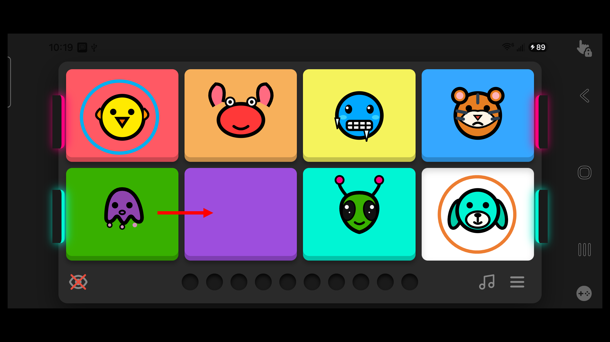
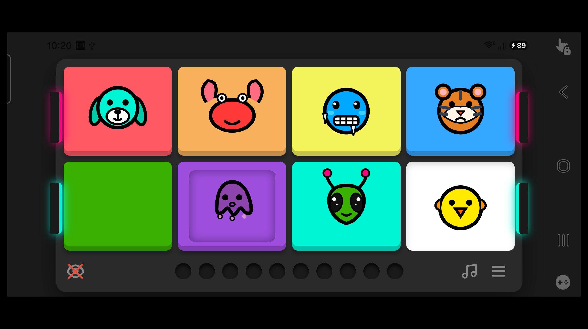
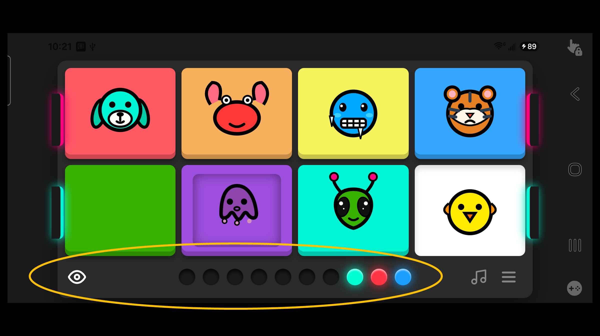

  

# Slide 'N Swap

**A challenging puzzle game where you slide and swap characters on a 2x4 grid.**

[Launch Slide 'N Swap](https://markmcla74.github.io/slide-n-swap/)

---

## Rules and Instructions

   
  <em>The Goal: Scramble the puzzle and return it to this solved state. The unique slide-and-swap mechanics make finding the solution a true test of strategy!</em>

   
  <em>Example 1 — Sliding: Sliding the Purple Octopus down causes its two neighbors—the Orange Tiger and the Blue Cold Face—to swap positions.</em>

   
  <em>Example 1 Result: The resulting board state after the slide. Managing these paired swaps is what makes the puzzle tricky!</em>

   
  <em>Example 2 — Edge Wrapping: Characters on opposite outer edges wrap around via Pac-Man doors. Here, the Purple Octopus's neighbors are the Yellow Bird and Teal Dog.</em>

   
  <em>Example 2 Result: When the Purple Octopus slides right, it wraps to the opposite side while the Yellow Bird and Teal Dog swap places.</em>

   
  <em>Hint System: Tap the eye icon once to view the minimum moves required to solve. Tap twice to reveal the exact sliding sequence (e.g., Teal Dog, Red Crab, then Blue Cold Face).</em>

---

## Credits

* **Theoretical Basis:**  
  [Slide &amp; Swap on Cubic Graphs ↗](https://homepages.gac.edu/~jsiehler/games/slideSwap-start.html) by Jacob Siehler
* **Audio Credit:**  
  *Nebula* by [The Grey Room ↗](https://www.youtube.com/@GoldenPalmRecorders/featured) via Golden Palm Recorders

---

## Install Slide 'N Swap Directly from Browser

Slide 'N Swap is a Progressive Web App (PWA) that runs just like a native application when installed on your phone.

### 📱 iPhone — Safari
1. Launch [Slide 'N Swap](https://markmcla74.github.io/slide-n-swap/).
2. Tap the **Share** button in the browser menu.
3. Scroll down and tap **Add to Home Screen**.

### 🤖 Android — Chrome
1. Launch [Slide 'N Swap](https://markmcla74.github.io/slide-n-swap/).
2. Tap the **three-dot menu** in the top right corner.
3. Tap **Add to Home Screen** or **Install App**.

Once installed, Slide 'N Swap will feature its own home screen icon and launch seamlessly like any other app.

---

## 🚀 Get More Free Apps

You are welcome to download this app, or any of my other applications, directly from the Google Play Store. All of my apps are **100% free with zero ads**.

[Browse all apps by markmcla on the Google Play Store](https://play.google.com/store/search?q=markmcla&c=apps)
